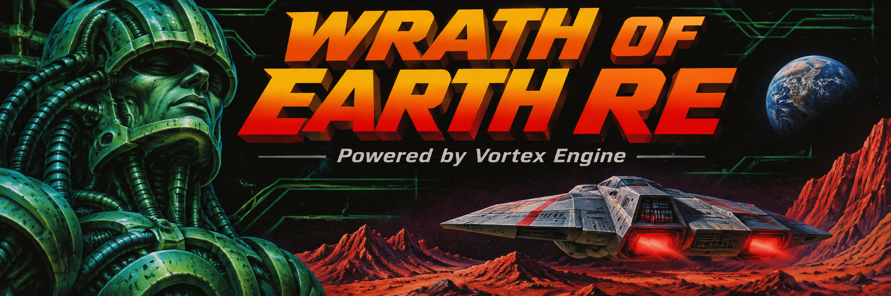

 

---

## Support the project

If you'd like to support development:

**[ko-fi.com/xxnukem](https://ko-fi.com/xxnukem)**

---

## About Wrath of Earth RE

**Wrath of Earth RE** is a planned, independent and unofficial reconstruction and modern-system port of *Wrath of Earth*, the 1995 MS-DOS science-fiction first-person shooter.

The original game combines combat, exploration and puzzle-solving on a remote colony threatened by hostile forces. Its distinctive futuristic setting, suit-based interface and unusual level design make it another overlooked piece of FPS history worth preserving.

Our goal is to recreate the experience faithfully, using the original DOS game as the reference for its graphics, level geometry, controls, sound, interface and gameplay. The intention is preservation rather than a remake or redesign.

**This repository is an announcement and project home, not a playable port.** Development has not started and no release date has been set.

## About Vortex Engine

  

[**Vortex Engine**](https://github.com/xXNukem/Vortex-Engine) is the independent C++17 engine developed alongside [Extremis RE](https://github.com/xXNukem/Extremis-RE), our reconstruction of *In Extremis* (1993).

*Wrath of Earth RE* is intended to become the **second game built using Vortex Engine**. It will test the engine's ability to support a different DOS FPS without embedding game-specific behaviour in the reusable engine libraries.

This project is also planned to guide the next stage of Vortex's development. In particular, we will investigate the rendering and world-geometry capabilities required by *Wrath of Earth*, including its more varied structural details. Any necessary engine extensions will be designed as reusable components while preserving compatibility with *Extremis RE*.

The engine does **not** yet implement every capability this game may require. Those requirements must first be verified against the original game and its resources.

## Project status

**Announced · Pre-development**

| Area | Status |
|:--|:--|
| Project announcement and repository | Published |
| Original DOS executable and resource research | Planned |
| Vortex Engine integration | Planned |
| Level geometry, textures and renderer adaptation | Planned |
| Player movement, combat and enemy behaviour | Planned |
| Original HUD, equipment, interface and audio | Planned |
| Automated tests and original-game comparisons | Planned |
| Modern platform releases | Not available |

No percentage of completion is claimed. The technical scope will be refined as the original game is studied.

## Development approach

The project will follow the same preservation-oriented principles as *Extremis RE*:

- Research the original DOS executable and data formats before implementing behaviour.
- Keep confirmed original behaviour separate from adaptations and unresolved details.
- Reuse Vortex Engine for shared rendering, audio and input services while keeping *Wrath of Earth* gameplay and resource parsing in this repository.
- Extend Vortex only for demonstrated requirements, without breaking existing consumers.
- Use focused regression tests and comparisons with the original game throughout development.
- Distribute no original copyrighted game assets.

## Downloads

**There are no builds or downloads yet.** This repository currently contains only the announcement README and its banner. Future development updates and releases will be published here.

For a playable reconstruction already in public beta, visit [Extremis RE](https://github.com/xXNukem/Extremis-RE/releases).

## License

Original software and associated documentation developed for Wrath of Earth RE are released under the [MIT License](LICENSE).

This license does not cover the original *Wrath of Earth* game, its copyrighted assets or the promotional banner. All rights to the original game remain with their respective owners.

## Credits and rights

**Reconstruction, reverse engineering and maintenance:** [xXNukem](https://github.com/xXNukem).

*Wrath of Earth* and its original intellectual property and assets belong to their respective rights holders. **Wrath of Earth RE** is an independent, unofficial, non-commercial preservation project and is not affiliated with or endorsed by the original developers or publishers.

No original game data, executable or copyrighted assets are included in this repository. The banner is newly created promotional artwork, not original game artwork.
